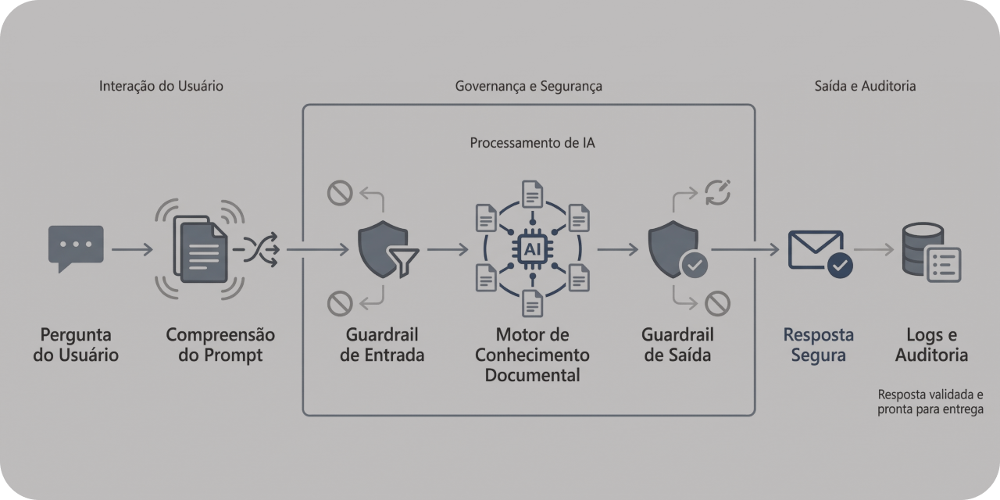

# DocLens

**Sistema RAG com auditoria adversarial e guardrails ativos para controle de comportamento em aplicações com LLM.**




---

## Visão Geral

A **DocLens** é uma Proof of Concept (POC) que demonstra como construir **chatbots baseados em Retrieval-Augmented Generation (RAG)** com mecanismos explícitos de **controle de comportamento e auditoria de riscos**.

O projeto explora como sistemas baseados em LLM podem ser tornados **observáveis, auditáveis e controláveis**, adicionando camadas de decisão entre a geração da resposta e a interação com o usuário.

A solução evolui de um chatbot RAG funcional para um sistema com **guardrails ativos**, capaz de:

* interceptar respostas inadequadas
* bloquear tentativas de exfiltração de documentos
* reescrever respostas sensíveis
* negar solicitações fora do escopo documental

---

## Problema de Negócio

Chatbots RAG são frequentemente utilizados para consulta de políticas internas, manuais operacionais e bases documentais corporativas.

Mesmo quando corretamente ancorados em documentos, esses sistemas podem apresentar comportamentos problemáticos, como:

* exposição indevida de conteúdo documental
* enumeração ou inventário da base de conhecimento
* respostas fora do escopo definido
* uso inconsistente ou inexistente de fontes
* tentativas de **jailbreak** parcialmente bem-sucedidas

Esses comportamentos reduzem a confiabilidade do sistema e representam riscos relevantes em ambientes corporativos.

Antes de aplicar bloqueios arbitrários, é fundamental **identificar empiricamente como o sistema falha** e, a partir disso, **introduzir mecanismos explícitos de controle e mitigação**.

---

## Abordagem da Solução

A DocLens implementa um sistema RAG estruturado em três etapas evolutivas:

### V1 — Baseline funcional

* chatbot RAG operando sobre base documental controlada
* respostas com citação de fontes
* ausência de mecanismos formais de controle

### V2 — Auditoria adversarial

* execução sistemática de **testes adversariais**
* classificação automática de riscos
* geração de logs estruturados em JSON
* produção de **relatórios técnicos de auditoria**

Nesta fase o sistema ainda não bloqueia respostas — ele é **observável**, permitindo identificar padrões de falha.

### V3 — Guardrails ativos

Na versão atual, o sistema passa a ser **controlável**.

São implementados:

* **guardrail pré-RAG** (análise de intenção do prompt)
* **guardrail pós-RAG** (avaliação da resposta gerada)

Cada interação pode resultar em uma decisão explícita:

* `allow`
* `block`
* `rewrite`
* `deny_out_of_scope`

Todas as decisões são registradas para fins de auditoria.

---

## Tecnologias Utilizadas

* Python
* LangChain
* FAISS
* SentenceTransformers
* Groq LLM API
* Streamlit

---

## Pipeline do Sistema

1. Ingestão e preparação da base documental
2. Criação do índice vetorial FAISS
3. Recuperação de contexto relevante (retrieval)
4. Geração de resposta via LLM
5. Avaliação da resposta por guardrails
6. Decisão de execução (`allow`, `rewrite`, `block`, `deny_out_of_scope`)
7. Registro estruturado da interação
8. Geração de relatórios de auditoria

---

## Estrutura do Projeto

```
doclens/

├── app.py
│  └─ aplicação Streamlit do chatbot RAG
│
├── audit/
│  ├── build_report.py
│  ├── prompts_phase.py
│  ├── run_tests.py
│  └── risk_rules.py
│
├── data/
│  ├── docs/
│  ├── index_faiss/
│  └── logs/
│     ├── app/
│     └── audit/
│
├── reports/
│  ├── app/
│  └── audit/
│
├── src/
│  ├── app_logger.py
│  ├── build_app_report.py
│  ├── guardrails.py
│  ├── ingest.py
│  ├── paths.py
│  ├── rag.py
│  └── vectorstore.py
│
└── README.md
```

---

## Resultados

A V3 da DocLens demonstra a viabilidade de incorporar **camadas explícitas de controle em sistemas RAG**.

A auditoria adversarial executada produziu, por exemplo:

* **15 testes adversariais**
* **12/15 interações interceptadas**
* **10/15 classificadas como alto risco**
* nenhuma anomalia operacional após calibração das regras

Os resultados completos (prompts, decisões, riscos e respostas) são registrados automaticamente em **relatórios técnicos disponíveis na pasta `reports/`**.

---

## Como executar

### Ambiente virtual

```bash
python -m venv .venv
source .venv/bin/activate
pip install -r requirements.txt
```

### Variáveis de ambiente

Crie um arquivo `.env`:

```
GROQ_API_KEY=sua_chave_aqui
```

### Executar o chatbot

```
streamlit run app.py
```

Os logs da execução são gravados automaticamente e podem ser convertidos em relatórios técnicos.

### Executar auditoria adversarial

```
python -m audit.run_tests
python -m audit.build_report
```

Isso gera automaticamente um relatório técnico em:

```
reports/audit/
```

---

## Status

**V1 — Baseline funcional:** concluída

**V2 — Auditoria adversarial:** concluída

**V3 — Guardrails ativos:** concluída

**V3.1 — Prompt-as-judge / julgamento semântico:** planejado

---

## Disclaimer

Esta POC foi desenvolvida exclusivamente para fins demonstrativos.

A entidade **“SDL Bank” é fictícia** e todos os dados utilizados são sintéticos.

Este projeto **não deve ser utilizado diretamente em ambientes produtivos**.

---

## Explore outros projetos do Small Data Lab

Este projeto faz parte do **Small Data Lab**, um laboratório técnico dedicado à experimentação aplicada em dados, analytics e sistemas de IA.

- [LakeFlow](https://github.com/smalldatalabbr/lakeflow) — Pipeline Lakehouse para ingestão e organização de dados externos.  
- [RetailLens BI](https://github.com/smalldatalabbr/retaillens-bi) — Camada analítica BI-ready para diagnóstico operacional em e-commerce.  
- [DelayImpact](https://github.com/smalldatalabbr/delayimpact-analytics) — Análise que investiga o impacto de atrasos logísticos na satisfação do cliente.  
- [CampaignSense](https://github.com/smalldatalabbr/campaignsense) — CRM Analytics para priorização de campanhas baseada em propensão e ROI.  
- [FraudWatch](https://github.com/smalldatalabbr/fraudwatch) — Sistema de decisão antifraude que transforma scores de ML em políticas operacionais auditáveis.  

---

# Onde me encontrar

[Portfólio](https://jhonathan.me) | [LinkedIn](https://www.linkedin.com/in/jhonathandomingues) | [Email](mailto:hello@jhonathan.me)

---

Este repositório é licenciado sob a MIT License.
